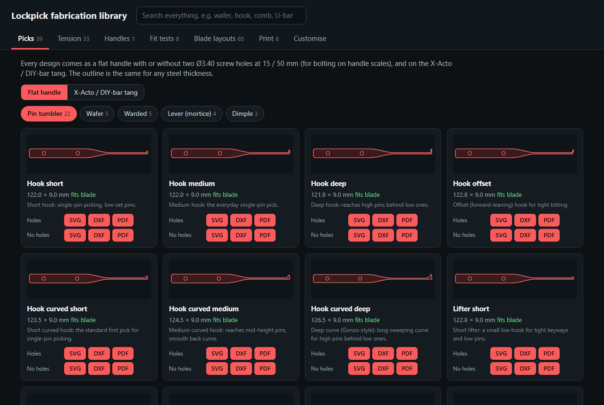

# Lockpick laser templates

Free cut files for making your own lock picks and tension tools at home: laser-cutter SVG/DXF, print-at-100 % A4 PDFs for people without a laser, layouts that fit a standard 12.7 mm hacksaw blade, and an in-browser customiser for designing your own. Everything is in millimetres at 1:1 with no kerf offset.

**Browse and download: https://theriseandfallofitall.github.io/lockpick-laser-templates/**



## What's in it

| Tab | What you get |
|---|---|
| Picks | Straight and curved hooks (short, medium, deep), lifters, half-diamonds, rakes (Bogota, snake, city, wave, triple-peak), combs, wafer balls, warded L/T, UK lever-mortice lifters and curtain wrenches, dimple. Each one comes as a flat handle with or without two Ø3.40 holes at 15 and 50 mm, and on an X-Acto / DIY-bar tang. Pin-tumbler picks also come as a flat-edge tang version: one straight side from tang to tip, laid on the hacksaw blade's back edge so that side needs no cutting |
| Tension | Top- and bottom-of-keyway tools sized from the lock (`docs/tension-sizing.md`), blade-fit and bend-after-cutting versions, and some advanced designs |
| Handles | A grub-screw bar handle you can make with hand tools or a lathe (`docs/diy-handle.md`) |
| Fit tests | A scale check and an X-Acto tang width series. Cut these first |
| Blade layouts | One file per hacksaw blade, with parts at least 6 mm apart, plus a laser jig that holds the blade |
| Print | Every design has its own PDF button. Print at 100 % / Actual size, glue the paper to the steel (or the hacksaw blade) and file to the line. Blade layouts tile across A4 sheets |
| Customise | Set the handle, holes, tang, shaft, sweep and tip, or the tension tool's corners, reliefs and S-curve, then download SVG/DXF or print 1:1. Each field has its own ↺ reset |

## Quick start

1. Open the site and cut the **Fit tests** first. The scale coupon must measure 50 × 20 mm.
2. Pick a design and download the SVG or DXF. In your laser software, import it at 100 %. The red / `CUT` layer is the cut. The blue / `REFERENCE-DO-NOT-CUT` layer is guides only.
3. Picks: 0.5–0.65 mm hacksaw blade or spring steel. Tension tools: flat bars from hacksaw blade or 1.0–1.25 mm spring steel; anything you bend after cutting needs bendable stock, not hacksaw blade (`docs/tension-sizing.md`, Which steel). A CO2 laser marks or cuts templates; the steel itself is cut with hand tools or a fibre laser.

## Rebuild the files

Python 3.10+, then `pip install -r requirements.txt`, then:

```
python build/generate_tension_tools.py        # --first-pin <mm> to size for your lock
python build/generate_home_workshop.py        # --tang-width <mm> for your collet, --blade-width, --gap
python build/generate_diy_handle.py
python tools/check_laser_files.py             # every SVG/DXF: mm units, closed outlines, SVG = DXF
python build/build_print_sheets.py
python build/build_site.py --page index.html
```

## Status and responsibility

These are untested prototypes. Fit, strength and durability have not been checked on real locks, so make one and try it before making a set. Only pick locks you own or have explicit permission to pick, and check the law where you live.

## Docs

| Doc | Read it for |
|---|---|
| [docs/tension-sizing.md](docs/tension-sizing.md) | How tension tools are sized from the lock |
| [docs/diy-handle.md](docs/diy-handle.md) | Making the grub-screw bar handle |
| [docs/xacto-tang.md](docs/xacto-tang.md) | Why the X-Acto tang is 5.80 × 10 mm, and how to measure yours |
| [docs/external-resources.md](docs/external-resources.md) | Published dimensions used, with sources |
| [docs/code.md](docs/code.md) | What each script does |
| [docs/moves.md](docs/moves.md) | Renamed and moved paths |

## Repo map

| Folder | Holds |
|---|---|
| `generated/` | All cut files, by family (`other-lock-picks`, `tension-tools-v2`, `hacksaw-blade-layouts`, `xacto-tang-v2/fit-tests`, `calibration`, `diy-handle`, `print-sheets`) |
| `build/` | Generators and the site builder |
| `tools/` | `check_laser_files.py` |
| `site/` | The customiser script |
| `previews/` | Display-only thumbnails for the site |
| `validation/` | Checker report |
| `docs/` | Topic docs |
| `.githooks/` | Layout check. Turn it on with `git config core.hooksPath .githooks` |

Licence: see `LICENSE`.
